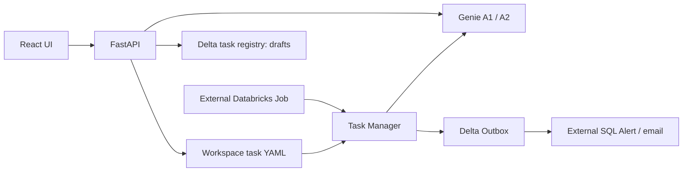

# Business AI Hub

Databricks Workspace exports preserved for continued development. Business data is simulated, as confirmed by the project owner. Source exports are kept in their original directory structure and have not been rewritten.

## Components

| Directory | Purpose |
| --- | --- |
| `business-ai-hub/` | React/TypeScript/Vite frontend and FastAPI backend; Databricks App deployment root |
| `business-task-manager-v1/business-task-manager-v1/` | Python/Spark task executor, four YAML task definitions, prompts, templates, Outbox SQL |
| `Douyin_Business_Cockpit/Douyin_Business_Cockpit/snapshots/v1_2026-10-13/` | Exported snapshot placeholders; all five files are empty |
| `database/` | Registry DDL provided by the owner; preserved for reference, not executed |
| `docs/` | Baseline audit and export checksums |

## Current architecture

Registry drafts are not consumed by the executor. The original Job and Alert settings are not exported here. The diagram describes the code's intended integrations, not verified live deployment or delivery.

## Baseline

- Tag `databricks-hub-export-2026-10-20` preserves the original 14-file Hub export.
- A subsequent commit adds the external exports, supplied Registry DDL, this index, ignore rules, and audit records.
- `docs/export-sha256.json` records the hashes of all 45 original exported files, including empty files and Databricks manifests. `.DS_Store` is excluded.

## Development entry points

Frontend and backend dependencies are declared in the exported manifests. From `business-ai-hub/`, `npm install` followed by `npm run build` runs TypeScript checks and builds `frontend/dist`. The backend requirements are in `business-ai-hub/requirements.txt`; local backend startup is `uvicorn app:app --host 127.0.0.1 --port 8000`. Databricks credentials and resource permissions are required for the remote API routes. Do not use CRUD or chat calls as a local smoke test against the live Workspace.

Task Manager's `main.py` requires a Databricks Spark runtime. It can call Genie and write to Outbox. Preserve current configuration until execution is explicitly requested.

`business-ai-hub/app.yaml` starts Uvicorn using `DATABRICKS_APP_PORT`. The root npm workspace manifest inside that app directory builds the frontend. The monorepo root is not the App deployment directory.

See [baseline audit](docs/BASELINE-AUDIT.md) for limitations and next development steps. Original deployment documents are historical and contain statements that differ from the exported configuration.
