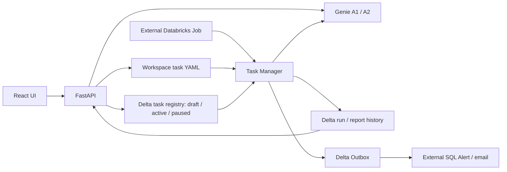

> **2026-10-21：当前实现与迁移入口**
> 业务调用已统一 Genie One；轻量模型仅做分流和任务信息提取；保存的 SQL 直接复用。
> 公司内网部署、个人 OAuth 与权限验收：[部署说明](business-ai-hub/README-DEPLOY.md)。
> 已下载的旧 Workspace 源码、Agent 知识与 Metric View 定义：[迁移清单](migration/README.md)。
> 云端导出是历史参考；运行当前维护目录，不执行归档配置。公司环境尚未部署或验收。

# Business AI Hub

Databricks Workspace exports preserved in baseline Git tags for continued development. Business data is simulated, as confirmed by the project owner. The original directory structure is retained; active development builds on the existing application.

Milestone 2B is implemented on the development branch: natural-language draft proposals through a configurable model adapter, editable review/save flow, improved schedule controls, and separate draft statistics. See [implementation, local checks and model setup](docs/MILESTONE-2B.md). Original export versions remain recoverable through the baseline tags; application files now include 2B changes.

Direct Gmail delivery, team-installed email templates and standard-SQL CSV exports are also implemented locally, disabled pending project OAuth and approved rollout. See [email delivery and local preview](docs/EMAIL-DELIVERY.md). CSV and sending never invoke an agent.

## Product direction: one continuous conversation

The primary experience must unify AI analysis and natural-language task creation in the same ongoing conversation. A user can investigate business data, then say “make this a weekly task” without re-entering the preceding context. Keep the dedicated task-creation UI/API as a shortcut and internal capability, not a separate long-term conversation experience.

- Carry forward the discussed brand/scope, metric definitions, comparison periods, thresholds and selected Agent into an editable task proposal. Ask only for unresolved information; disclose assumptions.
- Show the proposal and its confirmation in the conversation. Explicit saving updates My Tasks; activation remains a separate explicit action and does not start a Job by itself.
- Share configuration validation and persistence across both entry points. A unified conversation does not require collapsing all backend capabilities into one endpoint.
- Local conversation integration carries recent discussion into an editable proposal card, saves explicitly from chat, and refreshes My Tasks. The optional unified workflow now uses one structured model call for both semantic routing and draft extraction. Analysis, task, mixed and clarification paths share the conversation; dependent task drafts wait for analytical context. The dedicated task shortcut remains available. See [workflow and company Workspace handoff](docs/CONVERSATION-WORKFLOW.md). The complete user path still needs live acceptance against installed business definitions.
- Analysis prompts and business templates belong to the other team. Standard SQL exports CSV and ordinary code delivers email; neither operation should spend Agent calls.

Local draft review/activation and Genie-backed trigger SQL generation/testing are now available in the local test server. See [the trigger SQL workflow and its execution boundary](docs/CONDITION-SQL.md). Cloud execution remains paused.

## Permission architecture and Genie One integration

Interactive business queries should run with verified end-user authorization (OBO), so Unity Catalog table grants, row filters and column masks apply to the person asking. A shared App Service Principal gives every caller the same data permissions and is not a substitute for user isolation. Local CLI testing also represents only one identity.

Hub has a separate authorization responsibility for task definitions, SQL previews, generated reports/CSV and conversation history. The backend must derive owner/group scope from trusted login identity, validate each read/write/download and bind conversation IDs to that identity. Existing editable `owner` metadata and frontend visibility are not access controls. This multiuser authorization layer is not yet implemented; the current development instance is single-user.

The agreed interim policy is **creator-scoped execution**: record the task creator from verified login identity and use that identity's effective permissions for condition queries, report generation and SQL/CSV exports. Revalidate permissions at execution time rather than permanently retaining the creator's creation-time grants. The execution identity must not change implicitly when another user edits a task. The current executor has not yet implemented per-task creator delegation; editable `owner` text is not this binding. If authorized creator execution is unavailable, fail rather than use a more privileged shared identity. Browser login tokens must not become long-lived scheduler credentials.

Generate one report/artifact set per task run and send it to the creator-confirmed recipient list. Recipients need not have Databricks accounts; recipient-specific querying and N report variants are deferred. Email distribution is an explicit sharing action and does not confer direct table access. If people share one login, Hub can enforce that account's permissions but cannot distinguish the individual humans behind it. Before multiuser rollout, verify both data restrictions and saved-artifact access with users from different permission groups.

`business-ai-hub/genie_one_mcp.py` provides an identity-scoped, schema-discovered MCP transport using SDK credentials and the MCP Python SDK. `scripts/check-genie-one.py` only lists tools. The local workflow includes Genie One analysis with single-ask/serial-poll handling and SDK-derived local-user conversation ownership. It is off by default; the owner explicitly enabled interactive local testing on 2026-10-21 through `--enable-genie-one-chat`. No assistant-initiated inference was used for that enablement. Native scheduling restrictions and production OBO/ACL remain unverified; analytical prompts and local routing guards are not an upstream capability restriction. The existing `/api/chat` and task conditions/reports retain A1/A2. No provider fallback or permission change is automatic.

On 2026-10-21, authenticated tools/list succeeded in the current Workspace under the existing CLI profile. All four expected tools and their input/output schemas were available. The advertised polling schema includes optional `query_items[].sql`; live answers, SQL availability and semantic accuracy remain untested. Zero inference/tool-execution calls were made during discovery. This does not establish App/OBO/Job identity permissions.

## Components

| Directory | Purpose |
| --- | --- |
| `business-ai-hub/` | React/TypeScript/Vite frontend and FastAPI backend; Databricks App deployment root |
| `business-task-manager-v1/business-task-manager-v1/` | Python/Spark task executor, four YAML task definitions, prompts, templates, Outbox SQL |
| `Douyin_Business_Cockpit/Douyin_Business_Cockpit/snapshots/v1_2026-10-13/` | Exported snapshot placeholders; all five files are empty |
| `database/` | Registry DDL provided by the owner; preserved for reference, not executed |
| `docs/` | Baseline audit and export checksums |

## Current architecture

Milestone 2C is implemented locally: Registry activation/pause/edit workflow, executor integration, execution/report history, and the existing Outbox notification adapter. See [2C scope, validation and rollout requirements](docs/MILESTONE-2C.md). Execution is disabled by default. The existing cloud App and paused Job have not been updated; cloud execution and email delivery remain unverified.

The original Job/Alert settings are not exported as deployable configuration. Read-only discovery confirmed the existing Job is still PAUSED, runs daily at 09:00:21 Asia/Shanghai, and has one concurrent run.

## Baseline

- Tag `databricks-hub-export-2026-10-20` preserves the original 14-file Hub export.
- A subsequent commit adds the external exports, supplied Registry DDL, this index, ignore rules, and audit records.
- `docs/export-sha256.json` records the hashes of all 45 original exported files, including empty files and Databricks manifests. `.DS_Store` is excluded.

## Personal local testing

Run `python scripts/dev-local.py` after installing backend development requirements and building the frontend, then open **http://127.0.0.1:8765**. Drafts and review state are saved to a separate local SQLite database. Explicit SQL-tool clicks may query Genie/Databricks; cloud Registry writes, Jobs and mail remain disabled. Real model parsing is opt-in and requires separate authorization. The earlier `scripts/preview-local.py` is UI-only and cannot save. See [local testing details](docs/EMAIL-DELIVERY.md).

The local launcher now automatically records test-stage timings and observed model/MCP/SDK/SQL calls to a **separate local metrics SQLite database**. It does not require Codex/browser monitoring or issue extra provider calls. The workflow inspector's **导出全部测试数据（JSON）** downloads the persisted records. Unknown provider-internal tokens, DBUs and prices remain unknown. See [recording scope and interpretation](docs/CONVERSATION-WORKFLOW.md#automatic-test-measurements).

## Development entry points

Frontend and backend dependencies are declared in the exported manifests. From `business-ai-hub/`, `npm install` followed by `npm run build` runs TypeScript checks and builds `frontend/dist`. The backend requirements are in `business-ai-hub/requirements.txt`; local backend startup is `uvicorn app:app --host 127.0.0.1 --port 8000`. Databricks credentials and resource permissions are required for the remote API routes. Do not use CRUD or chat calls as a local smoke test against the live Workspace.

Task Manager's `main.py` requires a Databricks Spark runtime after explicitly enabling execution. It consumes enabled YAML and active/enabled Registry tasks, can call Genie, and writes run history and Outbox. Its default `execution.enabled: false` guard stops before creating Spark. Do not enable or invoke it remotely until execution is explicitly authorized.

`business-ai-hub/app.yaml` starts Uvicorn using `DATABRICKS_APP_PORT`. The root npm workspace manifest inside that app directory builds the frontend. The monorepo root is not the App deployment directory.

See [baseline audit](docs/BASELINE-AUDIT.md) for limitations and next development steps. Original deployment documents are historical and contain statements that differ from the exported configuration.
