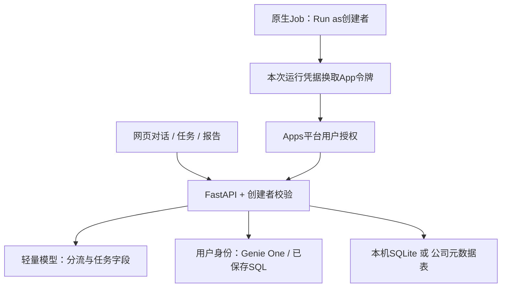

# Business AI Hub

2026-10-23：基于现有Databricks项目持续开发。当前业务统一调用Genie One，轻量模型负责分流/任务提取，已审核的条件SQL可直接重复执行。公司环境尚未部署或完成真实权限验收。

## 公司电脑：Git + Python单人试用

仓库包含编译网页，普通运行不需要Node、Docker或Databricks CLI。需要Python 3.11+（建议3.11/3.12）、公司允许的依赖源、浏览器和公司Databricks网络访问。

Windows PowerShell，在项目根目录：

```powershell
python -m venv .venv
.\.venv\Scripts\python.exe -m pip install -r requirements.txt
Copy-Item config/company-local.yaml config/company-local.private.yaml
.\.venv\Scripts\python.exe scripts/run-hub.py --config config/company-local.private.yaml
```

打开 http://127.0.0.1:8765/ 。SDK会打开公司Databricks登录；无须提供密码/Token给代码或聊天工具。TASK_PARSER_ENDPOINT暂为空，填入获批的公司模型名称后才可自然语言生成，手工草稿可先用。登录/资源权限仍由公司控制。

完整Git克隆/更新步骤见 [GIT-SYNC.md](docs/GIT-SYNC.md)，本机准备见 [START-HERE.md](docs/company-transfer/START-HERE.md)。已有ZIP目录先保留，首次Git克隆用新文件夹。

## 功能与范围

- 连续业务对话，分析/任务/混合请求分流，可视化流程与耗时。
- 自然语言和手工创建草稿、可编辑预览、保存、审核启用/暂停。
- Genie One生成条件SQL；参数化只读测试及重复执行；定性AI条件与明确的未知/失败结果。
- 手动试运行、运行记录、报告历史、邮件预览与明确确认发送；不触发就不生成报告。
- Apps用户OBO、任务/报告按创建者隔离，以及原生Job Run as创建者的后台入口代码。
- 本地测试计时/已知调用与用量记录；未知Genie内部token、DBU和费用不记作0。

公司模型、正式指标、模板、邮件和真实双用户权限需现场接入验收。CSV受控导出尚需适配；接口或模板代码不代表公司已可用。所有周期调度和自动发信均未默认开启。

## 配置选择

| 文件 | 用途 |
| --- | --- |
| config/local.yaml | 原开发电脑/个人Workspace，保持原设置 |
| config/company-local.yaml | 公司Workspace＋本机单人浏览器登录＋独立SQLite；当前先试这条 |
| config/company.yaml | 内网多人服务器，需HTTPS、个人OAuth及独立存储身份 |
| config/company-apps.yaml | Databricks Apps平台SSO/OBO与持久元数据；待批准部署 |

local描述本机运行/存储方式，不表示连接个人Workspace。公司电脑用company-local配置，不用原local.yaml。多人/长期后台托管不能直接复用单人localhost入口。

## 当前架构



原生Job→Apps链路不要求员工持续登录，但依赖可用的App/计算资源与公司令牌交换支持，尚待真实验收。只在公司电脑运行的localhost不能作为Job回调地址。

## 文档与示例

- [统一审阅入口](docs/REVIEW-INDEX.md)
- [完整测试建议](docs/PLATFORM-TEST-PLAN.md)：口径、Genie One、各功能事件、权限、调度、邮件和资源
- [OBO与Task权限](docs/OBO-AND-TASK-IDENTITY.md)、[后台Job实现与配置](docs/CREATOR-JOBS.md)
- [可分享的权限示例代码](examples/authorization/README.md)
- [公司接入准备](docs/company-transfer/START-HERE.md)、[界面审阅](docs/UI-REVIEW.md)

## 开发与版本保存

前端源码在business-ai-hub/frontend；修改前端后运行npm构建并提交最新dist。仅发布网页dist作为Python直用所需的生成文件纳入Git；不提交node_modules、虚拟环境、凭据、本机数据、报告/邮件或遥测日志。

根目录requirements.txt/app.yaml与deployment/databricks-apps中的运行模板对应。首次部署Apps需完整项目根目录，不只上传后端子目录。

原始导出及基线标签保持保留；[旧Workspace迁移归档](migration/README.md)仅供历史参考，不导入公司知识或自动执行其中的Job/Alert/建表配置。
