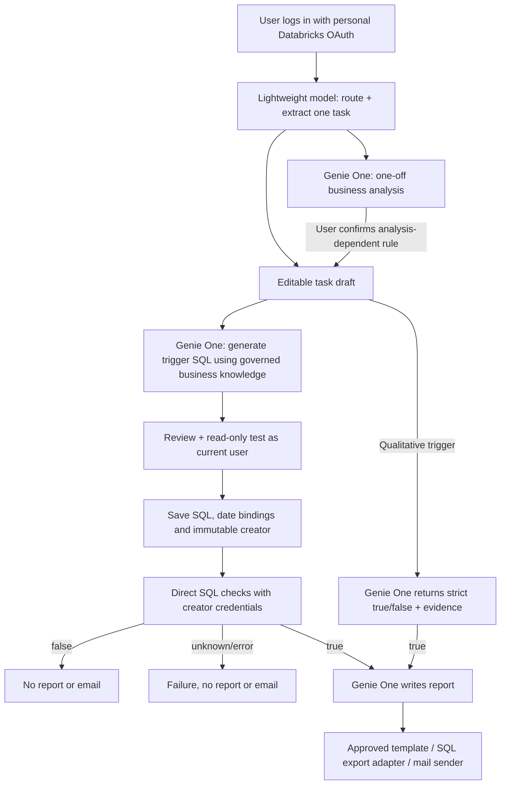

# Conversation workflow — current architecture (2026-10-21)

All business agents are now `genie_one`; the former two domain adapters/selectors
are removed from runtime. Genie One selects business assets internally and enforces
the caller's Unity Catalog access. No permissions are combined across agents.
The router has no scheduling tools. Task creation, review and activation stay in Hub.
SQL generation, explicit test, saving and activation are separate steps. A saved SQL
condition is parameterized and reused; no router or Genie generation call is needed
for later checks. Qualitative triggers remain fresh agent decisions.

`POST /api/conversation/analysis` consumes a short-lived, single-use ticket bound to
the authenticated Workspace/user. Conversation IDs are also owner-bound. A fresh
MCP adapter uses that request's user SDK credentials; it never caches another
user's client/token. Mixed requests can show an independent draft while analysis
runs; analysis-dependent rules wait for the user to confirm the analytical result.

Server-side task/report ACLs filter before pagination. Owner labels are display
metadata, not authorization. Creator metadata is assigned at save time and preserved
on updates. Legacy unowned cloud rows/YAML tasks are hidden until explicitly assigned
by a trusted migration; they are never claimed automatically by the first login.

Internal-server personal OAuth/PKCE is implemented but awaits company configuration
and live multi-user acceptance. Local testing uses the actual CLI identity on loopback.
Unattended execution requires a company-approved creator credential resolver; without
one, it stops before business queries. Automatic Job execution and sending remain off.

MCP tool allowlisting and prompts are defense layers, not proof of a provider-side
read-only or no-native-scheduling policy. Company rollout must validate upstream
capabilities, effective grants and permitted actions. Do not deploy a broad shared
identity to bypass per-user data restrictions.

Timings and available token/resource fields are recorded without an always-on
monitoring agent. Unreported Genie internal usage/cost remains unknown. No additional
paid inference was made for the 2026-10-21 authorization migration; tests use fixtures.

Configuration and company acceptance: [deployment guide](../business-ai-hub/README-DEPLOY.md).
