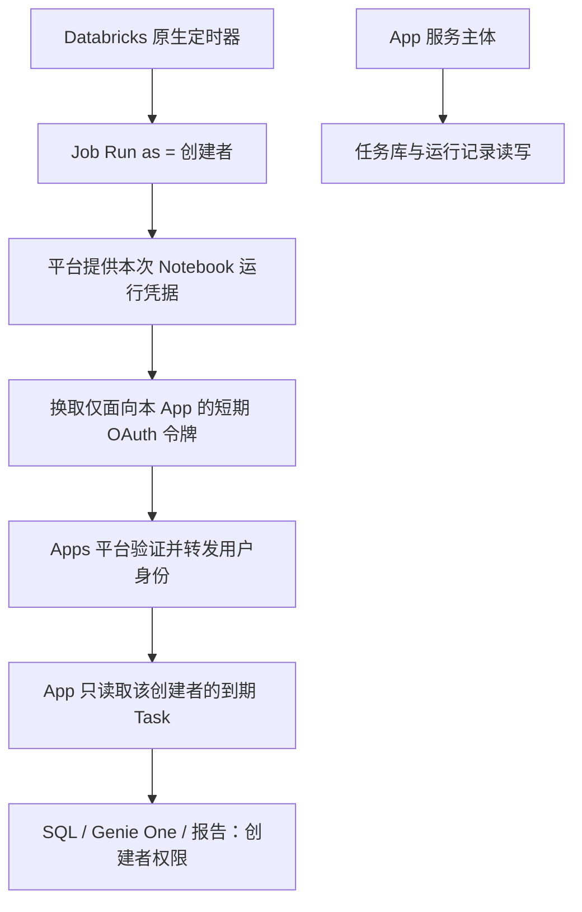

# 无需用户在线的 Task 执行：原生 Job 身份入口

2026-10-23。状态：代码与离线验证已完成；未创建、部署、启动任何公司 Job，尚未完成公司链路验收。

## 一眼看懂

公司只有一个 Business AI Hub App。每位任务创建者可配置一个原生 Job，处理其多个 Task。Job 负责定时唤醒和提供运行身份，已有 App/Task Manager 执行业务。



员工网页和电脑都可以关闭。App 服务与获批 Job 计算环境仍需可用；这是无人值守运行，不是脱离 Databricks 或断网运行。

## 为什么采用这个实现

- 每次 Job 运行都从原生运行环境取得本次身份，不依赖上次网页会话或 10 分钟内存缓存来启动下次任务。
- 不保存员工密码、个人长期 PAT 或浏览器 refresh token；不需要把整个执行器再部署一份。
- Job 不直接读写共享任务库，不给每个员工额外开放任务库写入权限，也不把 App 的元数据服务凭据交给 Job。
- App 按服务器验证出的创建者 ID 过滤；用户当前数据权限由 Databricks 检查。账号停用、权限收回、App 访问权撤销会影响后续执行。
- 同一日同一计划沿用原有执行记录去重；所有领取操作仍在单个 App 执行进程中，避免 Job 与网页各自维护一套认领账本。

## 已保存的代码与配置

| 文件 | 用途 |
| --- | --- |
| `business-ai-hub/creator_jobs.py` | 受保护的 Job 调度及精简状态 API，校验创建者与获批 Job 绑定 |
| `business-ai-hub/creator_job_client.py` | Notebook 令牌交换、调用 App、等待报告结果；不打印业务报告或凭据 |
| `scripts/creator-job-notebook.py` | 原生 Jobs Notebook 入口；确认 Run as 的实际用户与 Workspace |
| `scripts/prepare-creator-job.py` | 本地生成待审 Job JSON，无云调用 |
| `config/creator-job.example.json` | 单个创建者的公开资源配置，无凭据 |
| `config/creator-job-bindings.json` | App 侧获批创建者与实际 Job ID 映射；默认空 |

Notebook 中共用同一份源码，只替换创建者配置文件。Job 模板复用已有获批 cluster，不创建 cluster；SQL Warehouse ID 不能当作 cluster ID。依赖 `databricks-sdk>=0.122.0,<1` 和 `requests>=2.31,<3`；公司需提供支持 Notebook 身份机制的 Runtime。

## 配置与权限：之后获批再做

1. 公司部署 App，启用用户授权，配置 `deployment/databricks-apps/user-authorization.json` 的 scope；创建者拥有 App CAN_USE，并按公司规定完成应用级同意。
2. App 身份只获取元数据表所需权限；创建者获取其本来应有的 Warehouse、业务数据、Genie One 权限。无需让 App 获取员工全部业务数据权限。
3. 复制 `creator-job.example.json` 为该创建者的配置，填写：App URL、App **OAuth client ID**、Databricks 用户 ID/用户名、Workspace 源码及配置路径、已有 cluster ID。这里的 App OAuth client ID 是平台公开配置标识，不是密码，也不要擅自用服务主体 ID 代替。
4. 本地检查并生成待审 JSON：

   ```bash
   python scripts/prepare-creator-job.py --config config/creator-job.alice.json --output creator-job-review.json
   ```

   输出的 `job_settings` 才是待提交的 Jobs 定义；外层还附有绑定占位说明，不要把整个外层对象作为 Jobs 创建请求。脚本不会上传、创建或启用任何内容，拒绝覆盖已有输出文件。
5. 由有权限者在公司创建或复用 Job，设置 **Run as = 对应创建者**。普通用户通常可设为自己；管理员受公司限制策略约束。模板默认 PAUSED、`max_concurrent_runs=1`、关闭任务自动重试和运行排队。
6. 将实际 Job ID 填进 App 的公开绑定文件，同一 Workspace/创建者只保留一个启用条目。示例结构：

   ```json
   {"version":1,"bindings":[{"workspace":"https://company-workspace.example","creator_subject":"actual-user-id","job_id":123,"enabled":true}]}
   ```

7. 后续批准小型烟测时才打开 `HUB_CREATOR_JOBS_ENABLED=true`。本轮仍为 false。保留业务执行开关，SQL 测试凭证需 App 的稳定外部 `TASK_SQL_REVIEW_SECRET`；不将个人本机密钥复制到公司。
8. 先手动运行一次暂停状态下的 Job，证明关闭网页仍可执行，确认后再单独批准取消暂停。

无需为这个 Job 调用入口额外让 App 管理所有人的 Job。Job 创建/Run as 配置仍由创建者或有权限管理员完成；没有通过浏览器提交任意 Run as 用户的接口。

## 运行行为与明确边界

- 模板按上海时区每小时触发一次“到期检查”，配合当前界面的整点业务时间。它不是开放“每小时报告”业务。检查延迟受 Job 启动、计算环境和 Warehouse 冷启动影响，不承诺整点秒级执行。
- 只有 active、enabled 且到期的 Registry Task 执行；草稿/暂停跳过。仍不自动补跑历史日期。
- 初次启用仍要求新鲜的条件测试凭证；已经审核启用且条件/窗口/创建者未变的周期任务，不会仅因测试凭证经过7天而停掉。执行时仍核验签名与内容绑定，编辑/重新启用需按审核规则处理；这与用户身份授权失效不同。App 签名密钥轮换会使旧凭证失效，需要重新审核。
- Job 端一次明确调度后等待结果；状态轮询会继续提供有效的机器请求身份。短期 App 令牌到期前重新从 Notebook 运行凭据换取，不要求用户回来登录。
- App 同时最多处理两个执行；明确标为未认领的 DEFERRED 任务，可在当前 Job 的有界批次中继续领取。HTTP 结果不确定时不重发调度请求；下一次检查仍受已有 slot 去重约束。
- 所有后台结果仍写原运行记录表，可在现有报告页面查看。Job 日志只输出状态、运行引用和耗时；不输出报告文本、SQL、令牌或收件人。
- **本轮不启用自动发信。** 条件 false 不生成报告，不进入发信；true 生成报告，仍需现有邮件预览/发送或之后批准的自动投递接入。
- App 验证的是真实用户身份及获批 Job ID 绑定。请求中的 `job_run_id` 用作关联线索，尚未在服务器通过 Jobs API 核验，账本明确标为 `job_run_id_verified_by_server=false`；不把它当作身份凭证。已获授权用户也能请求自己名下的到期检查，不能请求他人任务。
- App 停止时 Job 会失败；App 重启中断的记录不自动重放。继续采用单进程 App 执行器；多实例 Delta 原子认领不在本轮范围内。

## 公司现场仍需验证

| 检查 | 为什么不能仅靠离线测试确认 |
| --- | --- |
| Native Notebook 的实际 Run as 身份 | 依赖公司 Runtime、计算访问模式和 Job 配置 |
| Notebook → App audience token exchange | 依赖公司 OAuth 策略、App OAuth client ID、批准 scope 和网络 |
| API 请求经 Apps 转发用户令牌 | 依赖公司平台入口实际行为，不能用本地伪造转发头证明 |
| 用户身份继续调用 Genie One/SQL | 依赖资源权限、MCP 策略及下游调用身份 |
| App 及两张元数据表权限 | 依赖公司批准的表和 Warehouse 权限 |

任何一项失败时记录明确的 HTTP/错误类别，不创建替代资源或扩大共享身份权限。

官方依据：[Job Run as](https://learn.microsoft.com/en-us/azure/databricks/jobs/privileges)、[Notebook 调用 App 与 audience 令牌交换](https://learn.microsoft.com/en-us/azure/databricks/dev-tools/databricks-apps/connect-local)、[Apps 用户授权](https://learn.microsoft.com/en-us/azure/databricks/dev-tools/databricks-apps/auth)。Notebook 令牌交换已有官方示例；公司完整链路仍待现场验证。
