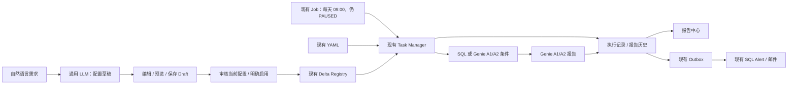

# Milestone 2C — Local execution integration

**Implemented and tested locally; cloud App/Job unchanged.** Existing Genie A1/A2 are the only execution agents. No metric views, business measures, data tables, Genie instructions, or examples are invented or required for framework tests. Their later installation belongs to the other team.



A subsequent local extension adds direct Gmail delivery and curated CSV exports; see [email delivery](EMAIL-DELIVERY.md). The original Outbox rollout described here remains the default until migration is approved.

## What is complete locally

| Area | Behavior |
| --- | --- |
| Natural language | Retains 2B real configurable parser adapter; no runtime mocks/fallback. One previously authorized CLI-user real parser check is recorded in the 2B evidence. No new inference in 2C. |
| Lifecycle | Draft → active → paused → draft. Saving/editing never enables a task. Activation requires explicit confirmation and acknowledgement of the review notes. Readiness returns the exact stored configuration/version being reviewed. |
| Draft editing | Existing form now edits saved drafts. Version checks reject stale edits/activation; state predicates stop edits/deletion after activation. Conditional provenance is preserved on partial edits. |
| Execution | Existing Task Manager loads YAML plus active/enabled Registry records. Drafts/paused tasks are skipped. Registry inline prompts/SQL/templates and original YAML file templates both work. |
| Scheduling | Daily, one weekday weekly, and anchored interval-days. Only the existing shared 09:00 Asia/Shanghai launch is supported for activation. Other times remain editable drafts. No hidden scheduler, Job mutation or implicit backfill. |
| Conditions | `always`, SQL returning exactly one native BOOLEAN `should_trigger` row (optional `reason`), or strict Genie JSON boolean decision. Malformed/unknown decisions fail visibly. |
| Reports | Uses the configured `genie_a1` or `genie_a2`, preserving the existing attachment-based SDK answer extraction. Report prompts receive explicit execution/business-date context and trigger reason. |
| History | Durable per-slot claim, status, exact config snapshot, condition reason, report text, sanitized error type and notification queue status. Reports page supports task/status filters, paging and Markdown report details. |
| Notifications | Reuses the existing daily/group Outbox and downstream SQL Alert. Combines pending reports; oversized batches fail without silent truncation. Outbox failure keeps reports pending without regenerating them, including recovery on a later dispatch day. Email sections identify the original execution day. |
| Database boundary | SQL values use named parameters. SQL result chunks are followed; truncated results fail explicitly. Registry read failure is visible, instead of silently hiding tasks. |

The existing four YAML task definitions, Genie Space IDs, App startup configuration and Job/Alert configuration were not changed. The Task Manager settings **do change locally** to declare Registry/history integration and a default-off execution guard. No table is automatically created by the executor.

## Read-only cloud findings — 2026-10-20

[Permission evidence](validation/milestone-2c-readonly-permissions-2026-10-20.json).

- App principal: `fbc62528-8dda-4dad-8835-c2c22016b422`, display name `app-164q7w business-ai-hub`, active, directly belongs to `account users`.
- The group has `USE_CATALOG` on `system` and `USE_SCHEMA` + `EXECUTE` on `system.ai`.
- The current CLI user's principal-specific effective-grants query on `system.ai.gpt-oss-20b` is denied: missing **READ METADATA** on the model service. **Final App access cannot be confirmed from these results.** Group grants alone do not rule out an effective denial.
- Unity Gateway uses UC privileges; this is not a legacy Serving endpoint `CAN QUERY` assertion. See [model service access governance](https://docs.databricks.com/aws/en/ai-gateway/govern-model-services).
- Existing Job `997638013141610` is PAUSED, runs daily at `09:00:21 Asia/Shanghai`, retains `max_concurrent_runs=1`, and has `send_alert` dependent on successful `run_task_manager`. These were read-only metadata queries. No remote SQL, Genie, parser inference, Job run, resource creation or permission update was performed in 2C.

**Latest owner evidence:** Catalog Explorer confirms inherited `EXECUTE` for All account users on `system.ai.gpt-oss-20b`. Parent group grants were observed earlier, but final App-effective `USE CATALOG` / `USE SCHEMA` remain unverified. Personal READ METADATA is not a prerequisite for continuing development. One App-authenticated inference is permitted at integration time; the local environment has only the personal CLI profile, so no new inference was attempted. See [the current App acceptance boundary](MILESTONE-2B.md#latest-app-identity-integration-boundary--2026-10-20). No new OAuth secret or resource has been created.

## Configuration for a later approved rollout

Nothing in this section has been applied remotely.

| Component | Required configuration |
| --- | --- |
| App parser | `TASK_PARSER_ENDPOINT=system.ai.gpt-oss-20b`, using existing SDK App authentication. App-identity inference acceptance remains pending. |
| App Registry | `TASK_REGISTRY_TABLE=workspace.douyin.business_task_registry_v1` (existing default); App needs SELECT/MODIFY and parent catalog/schema access. No Registry migration. |
| App history | `TASK_RUNS_TABLE=workspace.douyin.business_task_runs_v1`; App needs SELECT and parent access. Apply the proposed [history migration](../database/business_task_runs_v1.sql) only after authorization. |
| App activation | `TASK_EXECUTION_ENABLED=false` by default; enable only after migration, matching executor release/config and resource permissions have been verified. The flag never starts a Job. |
| Scheduling | App `TASK_DISPATCH_TIME=09:00`, `TASK_DISPATCH_TIMEZONE=Asia/Shanghai` must match Task Manager `schedule` and the existing Job. No Cron changes are proposed. |
| Task Manager | Release its updated files to the **existing** source directory; install its requirements, including `sqlglot==30.0.0`; configure `registry.table`, `execution.runs_table`, then change `execution.enabled` only after explicit execution approval. |
| Genie | Keep existing A1/A2 IDs in Task Manager `agents`; App keeps existing environment overrides. Executor run-as identity needs access to both Spaces and required data. A2 live acceptance is still pending. |
| Job run-as | Current Job runs as `lithomas@wustl.edu`, a different identity from the App principal. It needs Registry SELECT, history SELECT/MODIFY, existing Outbox SELECT/MODIFY, parent access, and Genie access. |
| Email | Reuse existing Outbox, recipient group `default`, Alert `962624129077297` and existing Job dependency. Do not create another Alert or send a test email without approval. Actual Alert query, recipient configuration, retry behavior and delivery require later acceptance. |

The simulation setting `business_date_offset_days: 487` is preserved. It maps execution dates to historical synthetic business dates; it is not a statement that data are current. Calendar-week/metric interpretation must be evaluated against the chosen synthetic-data period when cloud execution is authorized.

## Operational limits

- Run IDs include source, task ID and local calendar slot. Existing RUNNING, FAILED and completed slots are not automatically re-executed, even after config edits. Interrupted RUNNING / failed slots need operator review; no automatic paid-call retry or repair loop is added.
- Retain **one concurrent dispatcher** and the existing Job concurrency limit. Delta MERGE does not provide an enforced unique constraint; do not run the entry point from parallel Jobs or ad hoc notebooks. Duplicate IDs detected in the consumed task set stop dispatch.
- Pause prevents future snapshots from picking up a task; an execution already selected/claimed may finish.
- `QUEUED` means the report was written to Outbox, **not email delivered**. Outbox, execution ledger and external Alert do not share a transaction. A crash between publishing/marking/Alert execution requires inspection of both ledger and Outbox/Alert history before retrying. Exactly-once email delivery is not claimed. A later empty dispatch clears the daily Outbox payload to avoid sending stale reports.
- Failed task batches persist individual results and stop the downstream `ALL_SUCCESS` Alert task. Completed reports remain pending if a sibling task fails; a later approved dispatch can queue them without rerunning completed tasks.
- SQLGlot structurally restricts Registry trigger SQL to one SELECT/WITH query and rejects writes/commands. It does not validate metric semantics, table permissions, arbitrary UDF behavior or query cost. Activation still requires human review; execution identity permissions remain the boundary. See [SQLGlot parsing documentation](https://sqlglot.com/sqlglot.html).
- No per-user isolation or delivery receipt UI is added; this retains the existing App Authorization model.
- History pagination is bounded offset paging; refresh can reflect newly arrived records. It is not a frozen snapshot export.

## Local validation

From `business-ai-hub/`:

```sh
python -m unittest discover -s tests -v
npm run test --workspace business-ai-hub-frontend
npm run build
```

Install `requirements-dev.txt` in a venv and `npm ci` first if dependencies are absent. Backend suite also imports the existing executor via its repository path; production code does not depend on this test-only path setup. Task Manager's Spark dependency is supplied by the Databricks runtime.

Validation includes the real local parser validation/CRUD/lifecycle/calendar/execution orchestration code with **explicit mocked model, Registry/Spark, history and publisher adapters**. Generated ledger SQL is parsed locally in the Databricks dialect. It does **not** substitute for a live Delta/Spark transaction test, App identity inference, Genie business correctness, scheduler launch or email delivery test.

The integrated fixture scenario preserves the 15% conditional requirement, saves disabled Draft, verifies it does not execute, explicitly activates it, evaluates the condition, generates a report, reads history through the API, queues a combined notification, and verifies repeat dispatch makes no additional Agent calls. Other tests cover false/malformed conditions, SQL and A2 routing, schedule compatibility/interval anchors, disabled execution, failures, oversized reports, pending notification recovery, original YAML templates, stale edits, lifecycle review guards, bound values and chunked SQL results. React tests cover the existing 2B editing/preview flow plus activation confirmation, rollout gating, stale-state errors, report reading/filtering and explicit error states.

**Verified 2026-10-20:** 37 backend tests, 14 frontend tests, and the TypeScript/Vite production build passed. All new model/persistence/execution behavior was tested offline; no cloud run was performed.

After local checks, the next boundary is an explicitly approved rollout and controlled cloud acceptance. Metrics installation by the other team is not a blocker to the local framework implementation.
