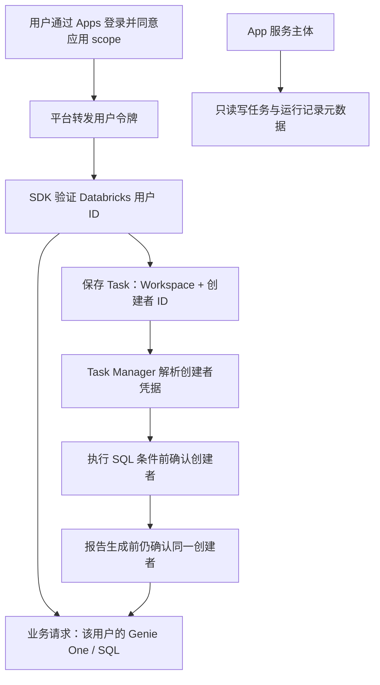

# Apps OBO 与 Task 创建者权限（2026-10-23）

## 结论

Task 的业务权限与创建者一致：**创建时绑定身份，执行时使用该身份的凭据，由 Databricks 判断当时的权限**。用户不用额外授权每个 Task；也不把创建时的数据权限复制、冻结或转授给 App。

这里的 App 是整个网站后端，Task Manager 是其中执行任务的部分。

**2026-10-23 后续更新：** 已新增原生 Job 身份入口，详见 [CREATOR-JOBS.md](CREATOR-JOBS.md)。后台首选方案改为“Job Run as 创建者 → 本次运行凭据换取 App 令牌 → 复用 App 执行器”；每次运行重新取得身份，不以浏览器令牌库作为长期执行前提。代码及离线验证已完成，公司尚未部署验收。下文长期凭据代理是可替换接口，不再是首选方案的必需资源。

## 已实现

- 公司配置 `HUB_AUTH_MODE=databricks_app_obo`，本地与共享试用不切换。
- 仅在匹配 Workspace、Apps 平台运行环境及受保护代理入口接受用户令牌；以 `current_user.me()` 的用户 ID 为准，邮箱、IdP actor、浏览器 owner 不决定权限。
- 显式 SDK 凭据策略，不使用 App M2M/个人 CLI 作为业务身份回退。元数据客户端仍使用 App 身份。
- 任务创建由服务端覆盖 security，已有任务与报告沿用 Workspace/创建者过滤。旧共享身份任务不会自动转给某个员工，需明确迁移。
- 手动执行在条件 SQL/AI 判断前和报告前校验创建者；调度在领取任务及工作线程中解析同一创建者。异步线程不读取全局共享用户客户端。
- 已验证的个人客户端自动短期保留在服务内存，最长 10 分钟；令牌失效会被再次验证发现。缓存无 refresh token、不写文件、不进入 ZIP、不承诺持久化。
- 后台解析可注入公司长期授权代理：`app.state.auth.creator_resolver = resolver`。接口为 `resolver(trusted_task_snapshot) -> Identity`；解析结果仍须验证真实 SDK 身份。该设置只允许服务端部署代码注入，没有浏览器指定身份的接口。
- 只读状态接口 `GET /api/tasks/{task_id}/execution-identity` 显示任务绑定、凭据可用性及代理配置状态；外人猜 ID 返回 404。`GET /api/session` 表示当前业务身份，不输出令牌。

## 尚不能冒充已完成的部分

**平台转发的 access token 没有长期刷新保证。单纯保存创建者 ID 不能让程序在几天后自动取得他的权限。** 公司长期凭据代理和公司真实双账号验收仍未完成；`background_delegation_ready` 保持 false。短期缓存支持当前进程内的受控执行，但不是每天定时任务的最终授权机制。

长期方案接入后，用户仍然只需应用级登录/同意，不增加逐任务授权步骤；刷新、失效和权限变更处理均在后台。不得用修改任务 owner 或切换成 App 服务主体来替代创建者授权。

默认不启动定时器、不调用线上模型、不发邮件。公司需要配置的 scope 与最小权限见 `company-transfer/APPS-PREPARATION.md`。

## 下午会议 demo 建议（约 5 分钟）

1. 使用当前本地站点：自然语言提出一个明确的数值条件任务，展示分流图、自动生成的条件 SQL、可编辑草稿与保存结果。真实调用由演示者手动点击。
2. 使用已准备的历史业务日期，展示同一任务的两条运行记录：条件不成立不生成报告；条件成立产生报告和邮件预览。尽量复用已存在记录，避免等待与额外调用。现场不必启用真实定时器或发送邮件。
3. 权限说明展示上述图和本次离线验证结果：Alice 创建、Bob 不可读；后台身份变化不生成报告。**清楚标为离线验证，不能说本地共享站点已实现真实双账号隔离。**
4. 公司 Apps 配置批准后，再用两个公司账号做最终权限 demo；不建议在会议前临时切换 Workspace 或部署。

## 本轮必要验证

离线验证覆盖：Apps 用户令牌绑定、缺失令牌不回退、SDK 在 App 环境中仍使用用户凭据、跨用户 Task/报告访问被拒绝、任务执行阶段身份变化被阻止、调度各阶段保持创建者。没有真实模型/SQL/邮件调用。

官方依据：[Apps 用户授权与 scope](https://learn.microsoft.com/en-us/azure/databricks/dev-tools/databricks-apps/auth)、[平台代理头及受保护入口](https://learn.microsoft.com/en-us/azure/databricks/dev-tools/databricks-apps/http-headers)。业务 MCP 下游是否按调用者执行还需公司端实际验证，不能只凭平台登录成功认定全链已验收。
