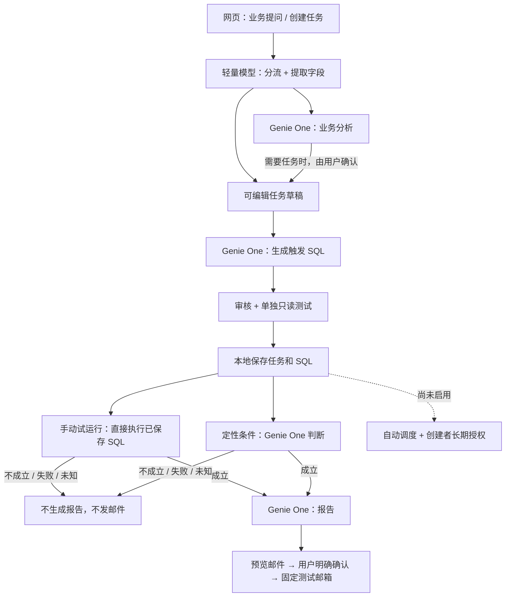

# Business AI Hub：当前功能与下一步

> 2026-10-23 更新：公司 Apps 用户 OBO、原生 Job Run as 创建者的后台入口及暂停模板已实现并完成必要离线检查，公司尚未部署/现场验收。旧的“必须长期托管用户 refresh token”不再是首选方案前提。最新状态和审阅入口见 [REVIEW-INDEX.md](REVIEW-INDEX.md)，后台说明见 [CREATOR-JOBS.md](CREATOR-JOBS.md)。下文为历史功能快照，不代表本轮已上线。

> 2026-10-22 更新：试运行/邮件已抽成独立 API，逐任务时间、下一次计划、执行去重与恢复已实现；自动调度仍关闭。公司部署现改为 Databricks Apps，旧内网服务器/OAuth 申请路径已被替代。详见 [最新执行与调度说明](RUNS-AND-SCHEDULING.md)。此前 ZIP 是旧快照，不含本轮更新。

更新：2026-10-21。本文根据当前代码、本机服务配置及既有测试记录整理；没有为核对状态重新调用模型、执行业务 SQL 或发送邮件。

## 先看结论

当前版本是可以交互测试的本地系统：提问 → 分流 → 分析/任务草稿 → SQL 生成与单独测试 → 保存审核 → 手动试运行 → 报告 → 邮件预览与明确发送。真实业务调用统一接 Genie One，普通模型负责分流与任务字段提取。

**定时自动运行尚未启用。** 本地“审核启用”是修改任务状态，不代表 Job 或后台调度已开始。公司多人正式使用、长期后台授权、正式邮件入口、CSV 数据导出仍需接入/验收。

公司管理员批准前，可以继续本地交互验收、页面整理、后台授权接口开发、正式试运行/邮件入口适配以及调度入口适配，不需要创建或改变公司资源。

## 入口与当前模式

| 入口 | 使用方式 | 状态 |
|---|---|---|
| 本机测试 | http://127.0.0.1:8765/ | 当前运行中；只在这台电脑访问 |
| 临时共享试用 | https://coastal-companion-casual-nancy.trycloudflare.com/ | 已通过外网 API 和手工草稿保存/删除检查；使用同一套开发配置和任务库，访客身份隔离按负责人要求暂停 |
| 公司环境 | 公司 Databricks Apps + 公司 Databricks API | 尚未部署，等待管理员准备 |

共享试用期间：所有访客使用同一开发者测试身份，可看到及修改共享任务；真实提问会产生开发 Workspace 的模型/查询调用，不是模拟 AI 回复。邮件仍走原有固定测试收件人、预览和逐次确认流程。没有自动调度，不会启动 Databricks Job。

原始个人 OAuth、任务/报告隔离、创建者绑定的代码继续保留。公司配置仍要求个人 OAuth；共享启动器只接受已授权的个人开发 Workspace，不允许用于公司环境。关闭共享进程即可结束临时外部访问。

## 已实现、当前可手动测试的完整功能

“可手测”表示代码及当前入口可用，不代表所有公司指标或 Genie One 全链路均已通过现场验收。

| # | 功能 | 当前能做什么 | 怎么测试/注意事项 |
|---|---|---|---|
| 1 | 网页工作台 | AI 分析、我的任务、分析报告三个页面；响应式布局 | 原本本机链接打开即可 |
| 2 | Genie One 统一入口 | 对话、SQL 生成、定性判断、报告均走 Genie One；不再选择 A1/A2 | 实际调用受开发身份的数据权限约束 |
| 3 | 普通业务提问 | 发送问题，显示真实分析回答及错误 | 发送会调用模型/Genie，可能查询数据 |
| 4 | 多轮对话 | 继续已有分析上下文；可重置新对话 | 对话仅保留当前页面；刷新会清空页面对话 |
| 5 | 智能分流 | 区分只分析、只建任务、两者都有、需要澄清 | 在右侧竖向流程中检查分流结果 |
| 6 | 独立分析和任务 | 混合请求中，独立草稿可先展示，分析继续返回 | 不必强行串行等待所有分支 |
| 7 | 先分析再建任务 | 条件依赖分析时先分析，用户核对后生成草稿 | 不自动替用户决定异常阈值 |
| 8 | 自然语言建任务 | 从统一对话或专门创建入口提取结构化配置 | 是可编辑建议，不自动保存或执行 |
| 9 | 手动创建任务 | 没有模型配置时仍能手填任务草稿 | 不把 mock 响应当成真实模型输出 |
| 10 | 可编辑预览 | 修改名称、说明、时间、条件、报告要求、通知设置 | 展示原始要求、假设、缺失信息和警告 |
| 11 | 草稿保存 | 本机 SQLite 持久化，刷新后仍能看到已保存任务 | 当前不会写公司或开发云端 Registry |
| 12 | 对话内任务操作 | 保存、详细编辑、审核启用、试运行、查看报告 | 不要求每次回到“我的任务” |
| 13 | 任务列表与统计 | 查看草稿、启用、暂停等状态及计数 | 统计不能理解为后台正在定时执行 |
| 14 | 草稿编辑与删除 | 修改草稿、确认删除；旧版本更新被拒绝 | 启用任务需先暂停/转回编辑状态 |
| 15 | 审核与状态切换 | 显式审核启用、暂停、恢复编辑；显示具体阻塞原因 | SQL/AI 条件需相应测试凭证；可预览下一次计划 |
| 16 | 计划字段 | 每日、每周、间隔、时间、时区及起始日期 | 支持逐任务任意时间审核与计划预览；自动调度未开启 |
| 17 | 触发方式选择 | 无条件、SQL、AI 判断，或条件待补充 | 数值条件优先 SQL；数据缺失不应自动改成 AI |
| 18 | 自动生成触发 SQL | SQL 草稿继续调用 Genie One，回填 SQL 与来源信息 | 失败保留草稿，可仅重试 SQL；生成可能查询数据 |
| 19 | 手工编辑 SQL | 用户可补充或修正生成的 SELECT | 改 SQL/周期后需重新测试 |
| 20 | 只读 SQL 检查 | 校验允许的 SQL 结构、限制结果规模、严格读取触发布尔值 | 这是应用防护，不代表上游 Genie 全部工具都绝对只读；业务权限仍需配置 |
| 21 | 指定业务日期测试 | 显示实际业务日期、本期/前期窗口和判断结果 | 支持日、完整周、滚动 7 天、日对上一完整周 |
| 22 | SQL 重复执行 | 保存参数化 SQL 后直接按日期执行 | 后续 SQL 检查不用再次问 Genie 生成 SQL |
| 23 | 定性 AI 条件 | 用业务问题/证据要求 Genie 返回严格 true/false 与依据 | 无法确认时显示错误，不静默当作不触发；业务判定仍需验收 |
| 24 | 一次手动试运行 | 明确点击后检查条件；成立再调用报告 Agent | 不启动 Job，不开启周期调度；重复请求去重 |
| 25 | 不触发/未知分支 | 不成立不生成报告或发送邮件；未知/失败明确报错 | 已有两任务、各两日期的历史验证，见下文 |
| 26 | 报告生成与历史 | 报告文本、执行状态、条件依据、错误和通知状态 | 旧报告可直接查看，不会因此重新生成 |
| 27 | 报告筛选 | 按任务等条件查看执行记录，支持分页 | 历史队列状态与真实邮件状态分开 |
| 28 | 邮件预览 | 生成邮件预览及稳定的内容指纹 | 不会仅因预览就发送 |
| 29 | 手动发信 | 用户再次确认后调用已有 Gmail 授权，发往固定测试邮箱 | 不允许从此试用入口任意修改收件人；不能自动发送 |
| 30 | 发信去重/不确定保护 | 已接受或结果不确定的邮件不自动重发 | 服务接受不等于所有邮箱必定投递成功 |
| 31 | 竖向分流可视化 | 消息、分流、分析/任务、SQL、保存状态及耗时 | 显示接口可证实的步骤，不猜 Genie 内部选了哪些资产 |
| 32 | 测试数据记录 | 各阶段耗时、SQL/模型/MCP 调用及提供方返回的用量 | 不需要 Codex 持续盯网站 |
| 33 | 测试记录导出 | 下载 JSON 请求/阶段记录 | Genie 内部 token、计算资源费用未返回时记为未知 |
| 34 | 配置切换 | 本地/公司两份 YAML，共用启动器与配置检查 | 公司必填项缺失则阻止启动，不回退个人配置 |
| 35 | 公司接入材料 | ZIP、编译网页、源码、建表与授权模板、管理员说明 | 已交付 ZIP 是打包时快照，不是自动同步到公司的部署 |
| 36 | 页面功能说明 | 页面顶部“功能与试用说明”，区分已开放及待接入功能 | 本次补充；刷新网页可见 |

## 已经验证过什么

- 本机服务健康；分流已启用，解析模型为 `system.ai.gpt-oss-20b`，业务提供方为 Genie One；本地试运行与邮件预览服务已开启。
- 当前本地数据库有 5 条任务、8 条运行记录；记录数不等于成功报告数。
- 先前两个测试任务、各两个业务日期，合计 4 个条件用例：2 次成立、2 次不成立。成立的 2 次生成报告并提交 Gmail，用户已查看对应邮件；不成立的用例不生成报告/发信。
- 上述真实报告邮件测试发生在统一 Genie One 及本轮授权调整之前，**不能充当当前 Genie One 完整链路已经复验的证据**。
- OAuth/创建者 ACL、跨用户隔离、SQL 测试凭证、Genie One 结构化 SQL、邮件去重等有必要的离线验证；公司双用户现场权限尚未验收。
- ZIP 已做前端构建、解压配置检查、文件 CRC/SHA-256 和建表字段对照；未包含凭据或本地数据库。

## 有代码/接口，但当前不能算完成的部分

| 项目 | 已有 | 还缺什么 |
|---|---|---|
| 公司个人身份登录 | OAuth/PKCE、服务端会话、当前用户 SDK、任务/报告隔离 | 公司 OAuth 注册、域名/网络、两用户现场验收 |
| 创建者权限后台执行 | CreatorRunner 接口及身份验证，禁止共享业务身份兜底 | 长期用户凭据存储/刷新/撤销解析器、Job 入口注入 |
| 自动定时执行 | 任务计划、执行器、执行记录、条件/报告适配器 | 无 Spark 的逐任务核心已实现；仍待公司定时器与无人值守授权，没有运行中的自动调度 |
| 正式环境手动报告与邮件 | 本地工作流、邮件组装与 Gmail 适配器 | 独立 API 和持久状态已实现；仍需公司 Apps 身份与发送授权接入 |
| 公司 Genie One | MCP 适配器、权限/工具边界 | 新 Workspace 连通、实际业务回答、Warehouse 绑定及超时适配 |
| CSV 附件 | 邮件附件/模板及标准 SQL 导出接口 | 创建者身份范围的受控导出适配器、业务团队定义的数据集；暂不提供给真实任务 |
| 业务指标与报告模板 | 系统支持配置，使用现有 Genie One 知识 | 另一团队提供正式口径/模板；本项目不负责重建这些知识 |

## 现在可继续推进的顺序

| 优先级 | 工作 | 是否依赖管理员 |
|---|---|---|
| 1 | 完成共享试用入口与页面说明，收集真实用户交互反馈 | 不依赖公司批准；仍用开发 Workspace |
| 2 | 将手动试运行/预览/确认发信从本地启动器抽成正式可复用入口 | 本地代码和离线验证不依赖 |
| 3 | 明确内网调度入口，减少当前 Spark 入口对部署方式的约束 | 可先写接口；真实部署/计算权限后续确认 |
| 4 | 实现可替换的创建者长期凭据解析器，并接入执行器 | 可先写接口与模拟测试；实际密钥系统接入需管理员 |
| 5 | 补 Genie One Warehouse 绑定、冷启动等待及明确错误信息 | 可先实现；实际调用另行批准/用户点击 |
| 6 | 核对公司 OAuth、专用元数据 Schema/身份和现有 Warehouse 权限 | 需要管理员 |
| 7 | 在公司完成双用户权限与一条完整任务链验收，再启用调度 | 需要公司批准与资源就绪 |

共享试用期间不把访客共用身份视为公司权限验收。公司元数据与业务资源没有因本次开发而创建、修改、部署或启用。

## 当前架构

## 持续打开时的成本

本次只读元数据核对：开发环境的 Serverless Starter Warehouse 当前为 STOPPED，Small，最多 1 个集群，空闲 10 分钟自动停止。没有为核对状态执行 SQL 或启动 Warehouse。

| 情况 | 增量费用 |
|---|---|
| 当前系统/网页开着，没有模型请求或查询，Warehouse 保持停止 | 新增云托管/隧道/推理/SQL 计算费用约 0 元/天；电脑电费和网络另算 |
| Cloudflare Quick Tunnel 保持连接 | 免费临时分享服务，没有为此租用云服务器 |
| 浏览页面、查看本机已保存任务/报告、手工保存草稿 | 当前使用本地 SQLite，不触发模型或业务 SQL；不代表未来公司 Delta 元数据存储同样无查询成本 |
| 访客发送问题、自动生成任务/SQL、试运行报告 | 会产生真实模型/Genie/SQL 用量，全部使用当前开发账户的额度或计费 |
| SQL 查询结束但 Warehouse 尚未自动停止 | 仍可能计入使用量；当前自动停止窗口为 10 分钟，连续查询会延后停止 |
| 公司未来内网服务器部署 | 服务器及公司现有资源费用由公司安排；不能套用本地免费托管结论 |

未获取实际账户合同价和全部 Genie 内部用量，因此不能准确给出“每次提问多少钱”。原有数据存储、已有模型专用吞吐部署等固定费用不属于本次分享新增费用，也未在本次审计中核算。后台没有开启周期任务；Codex 不需要持续监控网站。

官方说明：[Quick Tunnels 免费服务](https://blog.cloudflare.com/protected-quick-tunnels/)、[临时链接与运行限制](https://developers.cloudflare.com/tunnel/get-started/quick-tunnels/)、[Warehouse 自动停止定义](https://docs.databricks.com/aws/en/dev-tools/cli/reference/warehouses-commands)。

## 共享试用的使用边界

- 本地电脑和网络、原始 8765 服务、分享服务及临时隧道需要保持运行；电脑睡眠或连接关闭会使外部链接失效，重建隧道通常会换地址。
- 访客可以真实提问和修改共享草稿，不是只读演示；同时访问会看到同一份本机任务数据。
- 当前仍使用模拟数据和个人开发 Workspace；不要把公司业务数据/凭据加入这个临时共享模式。
- 正式身份控制代码未删除，公司配置始终要求 OAuth；恢复个人隔离不等于仅隐藏 UI 标签，需使用正式 OAuth 启动入口。
- 云端能力的状态以实际响应为准。本文不承诺每个业务问题都能生成语义正确 SQL；指标口径、数据完整性及 Genie One 整体输出仍需验收。
