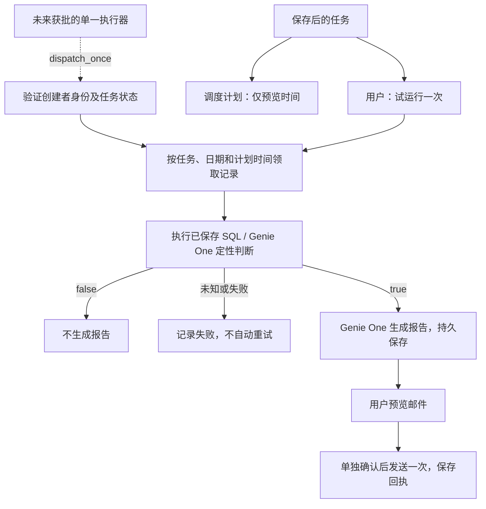

# 试运行与调度核心（2026-10-22）

本轮完成可复用 API、持久执行状态、逐任务调度核心与默认关闭的定时驱动器。**现有业务自动调度未启动，未部署公司 App。** 本地与共享试用仍使用原开发配置。

## 当前手测

1. 我的任务 → **调度计划**：查看每个任务的下一次时间、时区、当天是否已有记录。只读元数据。
2. 保存后的任务 → **试运行一次**：选业务日期、勾选确认、运行。支持手动刷新状态；弹窗可滚动，操作按钮固定底部。
3. 报告 → **预览邮件** → 核对并单独确认发送。本地仍固定使用原测试收件人。
4. 每日、每周、间隔任务的前端时间选择器仅提供整点 HH:00，不开放每小时重复；后端仍保留原有 HH:MM 能力，不增加整点校验或异常。审核不再强制 09:00。`TASK_SCHEDULER_MODE=fixed` 保留旧固定批次限制。

## 独立 API

| 方法 | 路径 | 行为 |
|---|---|---|
| GET | `/api/runs/settings` | 能力状态；未开放时不访问存储或云 |
| POST | `/api/tasks/{task_id}/trial` | 必须确认，校验任务版本、日期与请求键；返回运行编号 |
| GET | `/api/runs/{run_id}` | 阶段、结果、耗时和邮件状态 |
| GET | `/api/runs/{run_id}/email-preview` | 持久保存 MIME 与指纹，不发送 |
| POST | `/api/runs/{run_id}/send` | 必须确认且指纹匹配，只尝试一次 |
| GET | `/api/scheduler/plan` | 预览当前身份有权查看的任务计划 |

路由由 FastAPI 自身注册。`HUB_MANUAL_RUNS_ENABLED=true` 打开服务，默认关闭；正式邮件另需 `TASK_EMAIL_ENABLED=true` 和环境授权。本地继续注入原固定测试通道，旧 `/api/local-trials/...` 兼容历史记录。共享入口转发到同一本地服务。

重用 `TASK_RUNS_TABLE`：`config_json` 保存任务与权限快照；`artifacts_json` 的 `hub_run` 对象保存阶段、耗时、MIME/指纹。不新增云表，不存授权凭据，不依赖本地 MIME 文件；列表响应不会暴露内部 MIME。

## 调度与恢复边界

- 手动按任务、版本、业务日期去重；同一失败记录的重复重试只创建一个子记录。
- 定时按任务、当地日期和计划时间去重；当日到点后可补检查，不自动补历史日期。当天改成另一个时间视为新计划。
- 夏令时重复时刻仅一次；缺失时刻顺延到第一个有效分钟。
- 服务重启时，未完成运行标记失败；发送中邮件记为未知，均不自动重放。
- API 和未来调度必须共用**单一拥有领取权的进程**。SQLite 有唯一索引；Delta MERGE 不是跨进程唯一约束。尚未实现分布式调度。
- 旧 Task Manager 通知扫描排除新交互/调度来源，避免绕过手动邮件审核。

核心入口为 `RunService.dispatch_once(aware_datetime, resolve_identity, enabled=True)`。新增 `SchedulerLoop` 以默认 60 秒周期驱动这个入口，必须显式 `start(enabled=True)`；构造时不会启动线程或调用 SDK。无 HTTP 启动调度入口，没有新增或启动 Job。

只处理当前提供者有权读取、已启用且到期的 Registry 任务。解析器必须返回任务创建者身份，执行前核对 SDK 实际身份；领取后再次校验版本/暂停状态。并发上限两次，满载则本轮延期。SDK 授权无效留下失败记录；完全无法取得创建者身份时返回 `ExecutionIdentityUnavailable`、`claimed=false`，调用方应记录并提示重新授权，不能冒充创建者写入。

业务日期为任务当地日期前一天，复用已保存的周期/SQL 参数。模拟数据“上一个有数据日”与偏移仍仅用于本地手动测试。调度生成报告后不自动发信；未来自动投递需另行验收和启用。

## 验证与下一步

### 定时驱动器验收（2026-10-22）

运行 `python scripts/test-scheduler.py` 可复验。使用独立 SQLite、虚构身份和固定测试适配器，不读取现有任务库，不调用 Databricks、模型或邮箱。报告固定文本明确标为非 AI 生成。

一次有限测试流程包含 12 项断言：默认关闭、到点前不执行、到点后 true/false 分支、重复检查去重、暂停跳过、运行后暂停、重建执行器不重放、后台计时器启动及防重启、停止、跨整点一次执行、停止后不再检查及全程不发信。真实后台线程使用加速的测试时钟在约两秒内验证，并非生产墙上时间的整点验收。测试结果与隔离库保存在 `~/.local/share/business-ai-hub/scheduler-validation/`，不进入 Git/传输 ZIP。

驱动器记录最近检查时间、耗时、批次结果和错误类型，异常不会终止之后的检查；执行领取仍由原运行记录防重。后台线程不隐式继承浏览器会话，调用方必须提供明确的执行范围和创建者解析器。停止定时器不取消已领取的业务运行。

本地启动器新增 **`--enable-local-scheduler`**，必须同时使用 `--manual-trials`。只有显式添加该参数才会在服务启动后每 60 秒检查已启用任务，可能产生真实 SQL 和模型调用；不会自动发信。**本次没有给现有服务添加该参数。** 共享入口复用原服务，不启动第二个定时器。

`GET /api/scheduler/status` 返回真实驱动器状态、间隔、已检查次数与最近检查结果；调度计划与审核页面同步显示其是否开启。没有网页启停按钮。公司 Apps 未来复用同一驱动器，需替换本地 CLI 执行范围为获批的公司执行身份解析器。

本轮 10 个针对性后端检查（含 3 个旧流程兼容检查）、7 个前端交互/状态检查和前端构建通过。全部离线适配器，没有真实模型、业务 SQL 或发信调用。

公司下一步仍需 Databricks Apps 部署目录/身份适配、持久元数据表权限、创建者无人值守授权、获批定时器和公司邮件通道。当前 API 完成不代表公司授权或自动执行已完成；CSV、指标口径与模板按原计划之后接入。
