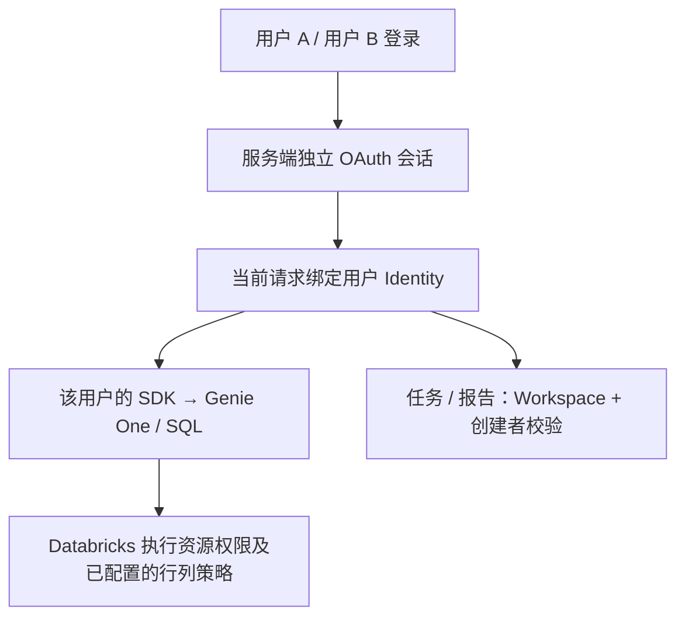

# 多账号数据权限：架构与示例

核心方案：**业务查询使用登录用户自己的 Databricks 身份；任务和报告再按创建者过滤。** 平台不复制一套表权限，由 Databricks 的 Unity Catalog、Warehouse、Genie 权限决定实际可访问的数据。



## 当前哪些模式有隔离

| 模式 | 实际数据身份 | 按访问者隔离？ |
| --- | --- | --- |
| 个人 OAuth 模式（代码已实现，公司尚未验收） | 各自登录的用户 | 有身份与归属边界；实际数据范围由 Databricks 授权决定 |
| 当前本地及外部共享试用 | 开发者的测试身份 | 无访客隔离；此前为方便测试而采用 |
| 公司 Databricks Apps 配置（`databricks_app_obo`，2026-10-23 已接代码，未部署验收） | 平台转发的用户令牌，经 SDK 验证身份 | 查询按用户权限；任务与报告按创建者隔离 |
| 可选旧模式 `databricks_app` | 统一 App Service Principal | 无用户数据隔离，不用于公司默认配置 |

**Apps 的平台登录，不等于业务查询使用登录用户的身份。** 新 OBO 适配器明确使用 `x-forwarded-access-token`，不回退到 App 身份；App 身份只供元数据存储使用。不同用户最终是否看到不同内容，还取决于公司实际配置的权限/行列策略。公司双账号验收尚未进行。

## 四个关键边界

1. **身份由服务端确认。** 浏览器不能通过传入 owner、邮箱或 security 字段指定执行身份。OAuth 凭据留在服务端内存，浏览器只拿到随机会话 Cookie；服务重启需重新登录。
2. **业务与存储分开。** 用户 SDK 查询业务数据；独立存储身份只处理任务元数据。读取列表先按 Workspace 和创建者过滤，再分页；按 ID 读取也需校验归属。
3. **SQL 校验与数据授权分开。** 只读 SQL 检查限制语句行为，不能替代 Databricks 的数据权限；也不能因为走 Genie One 就假定底层一定继承调用者权限，需在公司环境做双账号验收。
4. **后台任务绑定创建者。** 无逐任务额外授权步骤。服务端保存创建者绑定，手动执行与调度工作线程在 SQL 和报告阶段校验同一身份；不会把创建者权限复制给 App。`task_authorization.py` 自动短暂保留已验证的用户客户端，最长 10 分钟；这不是长期令牌库。公司持久授权、刷新和撤销所需的凭据代理尚待接入。邮件收件人不是执行身份，发送范围仍需业务方审核。

## 可给公司团队看的代码

[`user_bound_access.py`](user_bound_access.py) 复用现有身份和归属函数，展示：服务端写入创建者、绑定查询参数、阻止跨用户读取、只用用户 SDK 执行业务条件 SQL。它是集成示例，**不是另一个登录服务，也不会自动开启权限模式**。

离线检查（使用项目已安装依赖的 Python 环境；不连接 Databricks）：

```bash
python examples/authorization/user_bound_access.py
```

真实实现位置：

- `business-ai-hub/hub_auth.py`：OAuth 会话、请求身份、任务归属和请求校验。
- `business-ai-hub/app.py`：创建任务时覆盖 security，业务/元数据客户端分离。
- `business-ai-hub/creator_execution.py`：后台创建者身份解析与校验。
- `business-ai-hub/apps_auth.py`：Apps 用户 OBO 与独立元数据 App 身份。
- `business-ai-hub/task_authorization.py`：创建者凭据解析、临时内存缓存与后台代理接入点。

公司验收最少检查：A、B 分别登录；A 看不到 B 的任务/报告；B 猜测 A 的 ID 仍被拒绝；同一条受限业务查询按各自权限返回或拒绝；撤销创建者授权后后台任务停止执行。示例离线通过不能替代这些真实验收。
